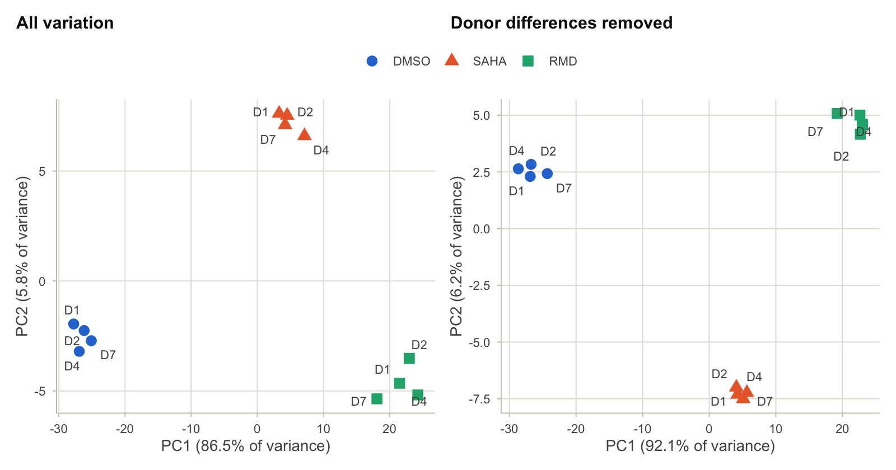
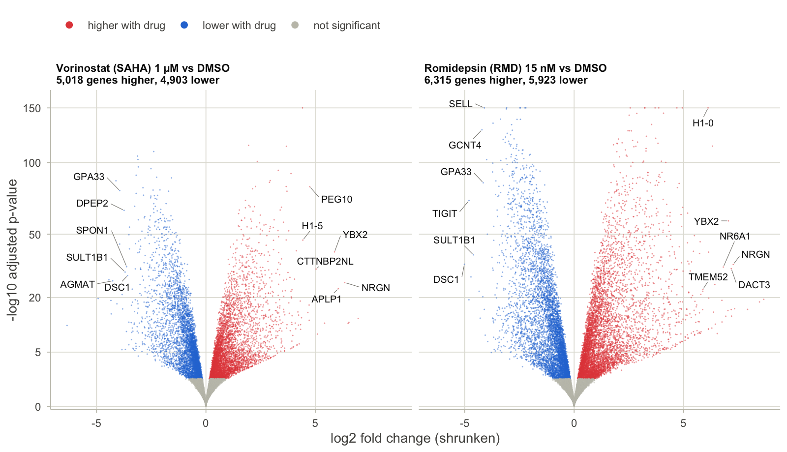
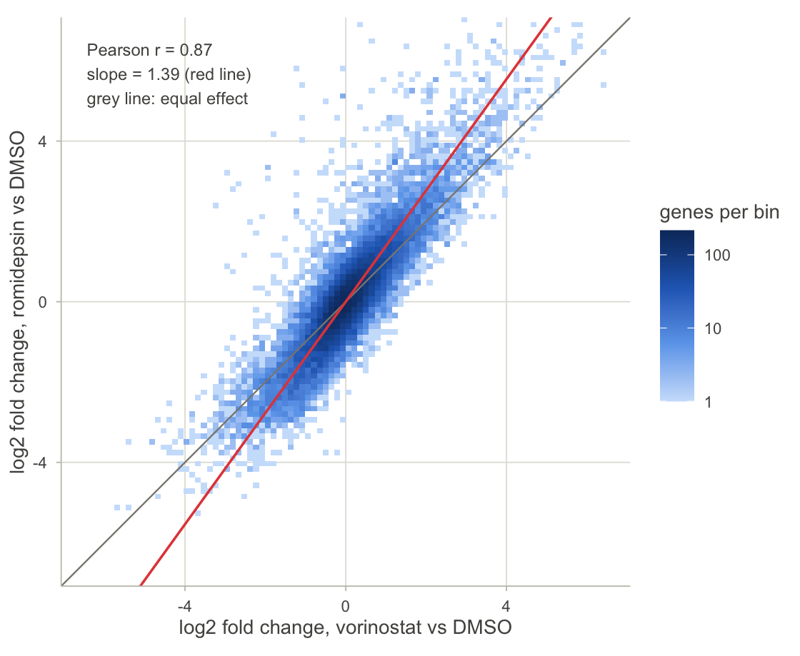
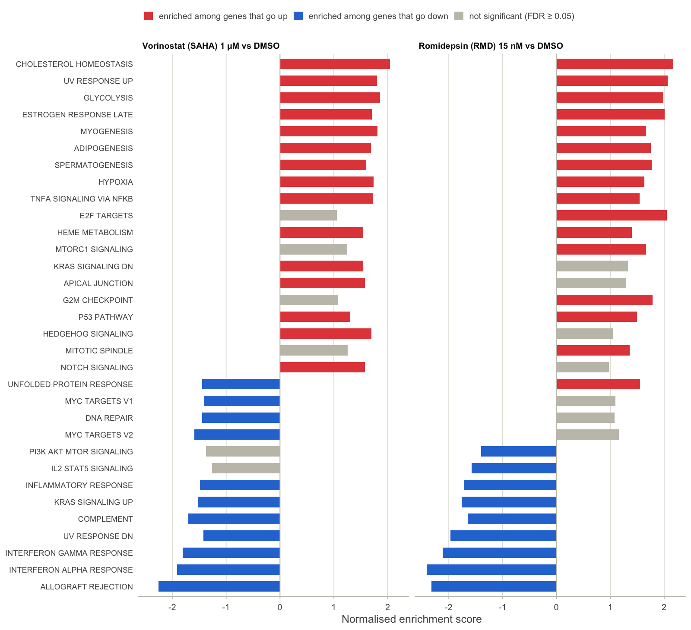
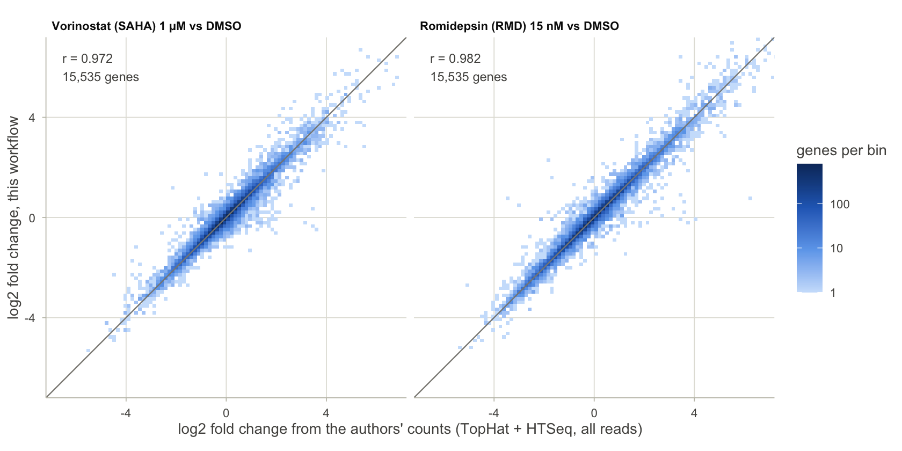
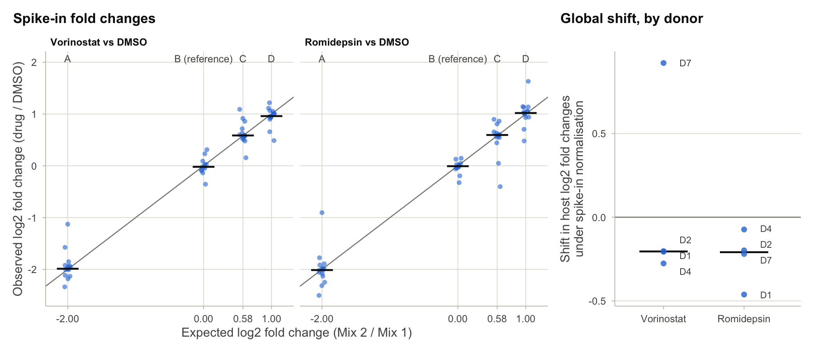
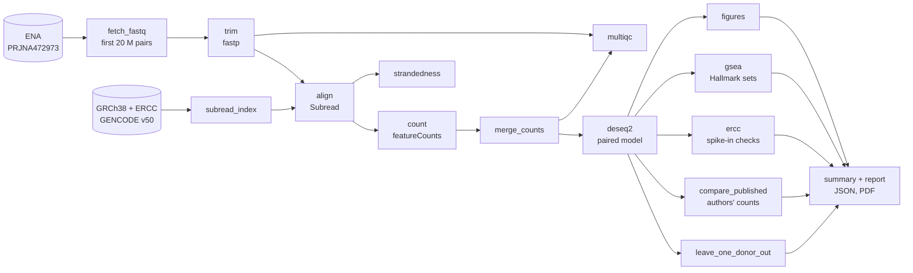

# hdaci-rnaseq

A reproducible RNA-seq workflow, from raw reads to differential expression and pathways, applied to a
drug-treatment experiment: **what do two HIV latency-reversing drugs, vorinostat and romidepsin, do to
gene expression in primary human CD4+ T cells?**

Snakemake runs every step. Alignment, counting and statistics are done in R/Bioconductor
(Rsubread, DESeq2, fgsea). Three checks are built into the workflow: the ERCC spike-ins in the
libraries, the count table deposited by the original authors, and a refit without each donor in turn.

**Full write-up:** [report/hdaci_rnaseq_report.pdf](report/hdaci_rnaseq_report.pdf)

## The question

Histone deacetylase (HDAC) inhibitors were among the first drugs tested in "shock and kill" strategies
for an HIV cure: reactivate the latent virus so that infected cells can be cleared. They also act on the
host cell. [Beliakova-Bethell et al. (2019)](https://doi.org/10.1074/jbc.RA118.005185) treated primary
CD4+ T cells from four donors with vorinostat (SAHA, 1 µM), romidepsin (RMD, 15 nM) or the solvent DMSO
for 24 hours and sequenced total RNA. This repository re-analyses the 12 uninfected libraries of that
study from the raw reads, with a different toolchain, and asks:

1. How many genes respond to each drug, and which pathways do they belong to?
2. Do the two drugs drive the same programme at different strengths, or different programmes?
3. How far can the answer be trusted?

## Results

| | Vorinostat vs DMSO | Romidepsin vs DMSO |
|---|---|---|
| Genes tested | 18,976 | 18,976 |
| Significant at 5% FDR | 9,921 (52%) | 12,238 (64%) |
| Up / down | 5,018 / 4,903 | 6,315 / 5,923 |
| At least two-fold after shrinkage | 3,580 | 6,024 |

**Both drugs change more than half of the expressed genes**, and the drug is by far the largest source
of variation in the data.





**They drive largely the same programme, and romidepsin pushes it further.** Fold changes correlate at
r = 0.87, and 98% of the 8,531 genes changed by both drugs move in the same direction. The slope between
them is 1.39: a gene that vorinostat doubles is raised about 2.6-fold by romidepsin, at a 67-fold lower
concentration.



**Immune programmes go down; metabolic and out-of-place programmes go up.** Of 48 Hallmark gene sets
tested, 19 are significant for both drugs and 18 of those point the same way. Interferon responses,
allograft rejection and the inflammatory response fall. Cholesterol homeostasis, glycolysis and gene
sets that describe other tissues (myogenesis, adipogenesis) rise.



**Known responses are recovered.** *H1-0*, a known HDAC-inhibitor response gene in lymphocytes, is the
most significant gene for both drugs (22-fold and 71-fold up). *CDKN1A* (p21), the classic
vorinostat-induced gene, rises about 3-fold with each.

## Can the result be trusted?

Three checks are part of the workflow.

**1. The authors' own counts.** The authors deposited counts made with TopHat and HTSeq from every read.
Fitting the same model to them gives fold changes that correlate with this workflow's at r = 0.972
(vorinostat) and 0.982 (romidepsin) across 15,535 genes. Of the genes called significant here, 95.5%
and 96.1% are significant in the same direction there. The full-depth counts find more genes (11,293
and 13,438), which is the cost of using a quarter of the reads.



**2. Spike-ins of known ratio.** The libraries contain ERCC spike-ins: Mix 1 in DMSO samples and Mix 2
in drug-treated samples, with known ratios between the mixes. The expected log2 fold changes of −2,
+0.58 and +1 are recovered as −1.99, +0.59 and +0.96 (vorinostat) and −2.01, +0.59 and +1.02
(romidepsin), with a slope of 0.98. Normalising by spike-ins instead of by DESeq2's default would shift
every fold change by a median of −0.20 (vorinostat) and −0.21 (romidepsin) log2 units. That is small
beside the effects reported, and because the two mixes are confounded with treatment it cannot be
attributed to the drugs. There is no sign of a large genome-wide shift that would break the default
normalisation.



**3. Each donor in turn.** Refitting the model without any one donor leaves the fold changes almost
unchanged (r of 0.98 or more), and no gene that stays significant changes direction.

QC flagged one library: in D7_SAHA only 42% of read pairs are assigned to a gene, against a median of
60%. It was kept. Leaving donor D7 out keeps 89% (vorinostat) and 94% (romidepsin) of the significant
genes, more than leaving out any other donor.

Every number above is in [`results/summary.json`](results/summary.json). The per-library QC is in
[`results/qc/sample_qc.tsv`](results/qc/sample_qc.tsv) and the MultiQC report in `results/qc/`.

## Workflow



| Step | Tool | What it does |
|---|---|---|
| `fetch_fastq` | curl | Streams each library from ENA and keeps the first 20 million read pairs |
| `trim` | fastp (Rfastp) | Adapter and quality trimming, per-library QC report |
| `subread_index`, `align` | Subread (Rsubread) | Aligns pairs to GRCh38 plus the 92 ERCC sequences; keeps uniquely mapped pairs |
| `count`, `merge_counts` | featureCounts | Read pairs per gene (GENCODE v50, reverse-stranded), one matrix for all libraries |
| `strandedness` | featureCounts | Counts one library three ways to confirm the library type from the data |
| `multiqc` | MultiQC | One QC report across all libraries |
| `deseq2` | DESeq2, ashr | Paired model `~ donor + treatment`, three contrasts, shrunken fold changes |
| `gsea` | fgsea | Gene set enrichment on the MSigDB Hallmark collection |
| `ercc` | DESeq2 | Fold-change accuracy on spike-ins; sensitivity of the result to the normalisation assumption |
| `compare_published` | DESeq2 | Fits the same model to the authors' deposited counts and compares fold changes |
| `leave_one_donor_out` | DESeq2 | Refits the model without each donor in turn |
| `figures`, `summary`, `report` | ggplot2, Typst | Figures, one JSON file with every headline number, and the PDF report |

## Design decisions

**20 million read pairs per library.** The libraries hold 77 to 89 million pairs each, about 166 GB for
the whole study. The workflow streams each file from ENA and stops after the first 20 million pairs
(`max_read_pairs` in the config; `0` uses everything). Reads at the start of a FASTQ file come from the
first tiles of the flow cell, and where a cluster sits on the flow cell has nothing to do with which
gene it came from. The cost of this choice is measured, not assumed: see the comparison with the
authors' full-depth counts below.

**Genome alignment, not transcript pseudo-alignment.** These are total-RNA libraries, so a large share
of read pairs comes from introns and unspliced RNA. Aligning to the genome lets featureCounts say
what happened to every pair (assigned to a gene, no feature, ambiguous) instead of forcing intronic
reads onto spliced transcripts.

**Uniquely mapped, reverse-stranded pairs only.** Pairs with more than one best location are dropped at
alignment. The strand setting is checked against the data rather than taken from the methods section.

**A paired model.** Each donor gave one DMSO, one vorinostat and one romidepsin library. With
`~ donor + treatment` every donor is its own control, so differences between people do not count as
noise against the drug effect.

**Shrunken fold changes for ranking, Wald tests for significance.** Low-count genes produce large,
unreliable fold changes; `ashr` shrinkage pulls those towards zero for plots and rankings. Significance
is called on the unshrunken test at a false discovery rate of 5%.

**GSEA on the full ranked list.** With thousands of genes changing, an over-representation test depends
heavily on where the cut-off is drawn. GSEA ranks every gene by its Wald statistic and needs no cut-off.

**Test the normalisation assumption.** DESeq2's size factors assume most genes do not change. HDAC
inhibitors act on chromatin across the whole genome, so that assumption is not safe by default. The
authors added ERCC spike-ins in proportion to cell number, which makes it testable.

## Run it

Requirements: R, Python 3.11 or later, `curl`, about 45 GB of free disk and 16 GB of memory. Tested with
R 4.6.2 and Python 3.12 on macOS (Apple silicon). No conda or Docker is needed: everything installs from
Bioconductor, CRAN and PyPI.

```bash
git clone https://github.com/soumyadeepreddu04-web/hdaci-rnaseq.git
cd hdaci-rnaseq

# Python tools
python3 -m venv .venv && source .venv/bin/activate
pip install -r requirements.txt

# R packages (optional: keep them in a project library)
mkdir -p .Rlib && export R_LIBS_USER="$PWD/.Rlib"
Rscript workflow/envs/install_r_packages.R

snakemake --cores 12 -n                              # dry run: lists the jobs
snakemake --cores 12 --resources ena_download=1      # everything, including the PDF report
```

`--resources ena_download=1` downloads one library at a time, which is as fast as ENA serves a single
client. On a 12-core laptop with 24 GB of memory the run takes about 70 minutes: roughly 35 minutes of
downloads (the genome index builds alongside), 27 minutes of trimming, alignment and counting, and a
few minutes of statistics and figures. To analyse every read, set `max_read_pairs: 0` in
`config/config.yaml` and allow about 170 GB of downloads.

## Repository layout

```
config/config.yaml          parameters: read cap, reference release, thresholds, threads
config/multiqc_config.yaml  MultiQC settings
config/samples.tsv          12 libraries: donor, treatment, ENA run, FASTQ URLs and checksums
workflow/Snakefile          the rules
workflow/scripts/           one script per step (R, plus a shell script for the downloads)
workflow/envs/              R package installer
results/qc/                 MultiQC report, per-library QC table, strandedness check
results/counts/             gene-by-library count matrix
results/de/                 DESeq2 tables for the three contrasts, normalised and transformed counts
results/gsea/               Hallmark enrichment table
results/ercc/               spike-in tables
results/published/          gene-by-gene comparison with the authors' counts
results/figures/            all figures
results/summary.json        every number quoted in this README and the report
report/                     Typst source and PDF of the write-up
```

## Limitations

- Four donors, one concentration of each drug, one time point (24 hours). The comparison of strength
  holds for 1 µM vorinostat against 15 nM romidepsin and says nothing about other doses.
- Uninfected cells only. The analysis describes the host response and does not measure HIV
  reactivation. The study's 12 libraries from a latency model are not analysed.
- Bulk RNA from mixed CD4+ T-cell subsets: a change in expression cannot be told apart from a change
  in the mix of cell types.
- A quarter of the reads, and uniquely mapped pairs only. Genes in repeated or multi-copy families are
  under-counted, and weakly expressed genes have less power than in the original study.
- When more than half of all genes are significant, the count of genes says little. Effect sizes and
  gene-set results carry the information.
- No experimental validation. This is a computational re-analysis of public data.

## Data and references

- Data: Beliakova-Bethell N, Mukim A, White CH, et al. Histone deacetylase inhibitors induce complex
  host responses that contribute to differential potencies of these compounds in HIV reactivation.
  *J Biol Chem* 2019;294(14):5576-5589. [doi:10.1074/jbc.RA118.005185](https://doi.org/10.1074/jbc.RA118.005185).
  GEO [GSE114883](https://www.ncbi.nlm.nih.gov/geo/query/acc.cgi?acc=GSE114883), ENA PRJNA472973.
- Rsubread and featureCounts: Liao Y, Smyth GK, Shi W. *Nucleic Acids Res* 2019;47:e47 and *Bioinformatics* 2014;30:923-930.
- fastp: Chen S, et al. *Bioinformatics* 2018;34:i884-i890.
- DESeq2: Love MI, Huber W, Anders S. *Genome Biol* 2014;15:550.
- ashr: Stephens M. *Biostatistics* 2017;18:275-294.
- fgsea: Korotkevich G, et al. bioRxiv 060012. Hallmark gene sets: Liberzon A, et al. *Cell Syst* 2015;1:417-425.
- ERCC spike-ins: Jiang L, et al. *Genome Res* 2011;21:1543-1551. Limits of spike-in normalisation: Risso D, et al. *Nat Biotechnol* 2014;32:896-902.
- Snakemake: Mölder F, et al. *F1000Research* 2021;10:33. MultiQC: Ewels P, et al. *Bioinformatics* 2016;32:3047-3048.
- Reference: GENCODE release 50 (GRCh38 primary assembly).

Code is released under the MIT licence. The sequencing data belong to the original authors.
